<h1 align="center">Md Hussain</h1>

  <b>Senior AI Product Engineer</b> · Voice AI · Agentic Systems · LLM Infrastructure · Bengaluru

  
  
  
  
  

I turn LLMs and voice AI into products people use every day. Nearly 5 years of software engineering, building production LLM, voice AI and agentic systems end to end, from the model layer to the app in people's hands.

**Now:** Senior AI Product Engineer at The Product Highway, building [Echo](https://echo.tphinfra.com) · my own AI SaaS, [Agentsman](https://agentsman.vercel.app/)

---

## 🎙️ Talk to my AI

My portfolio has an AI twin that knows my work and answers by **voice or chat**. GitHub can't run it inside a README, so here's a preview. Click it, or pick a question below, and it opens the real chat with your question already asked.

<a href="https://hussnakhtr.com/?ask=1">
  <picture>
    <source media="(prefers-color-scheme: dark)" srcset="assets/ask-ai-dark.svg">
    
  </picture>
</a>

**Ask it:**
[Would he fit my open role?](https://hussnakhtr.com/?ask=Would%20he%20fit%20an%20AI%20engineering%20role%3F) ·
[What did he build at Jivi?](https://hussnakhtr.com/?ask=What%20did%20he%20build%20at%20Jivi%20AI%3F) ·
[How does Echo work?](https://hussnakhtr.com/?ask=How%20does%20Echo%20work%3F) ·
[How did he cut voice costs by 75%?](https://hussnakhtr.com/?ask=How%20did%20he%20cut%20voice%20calling%20costs%20by%2075%25%3F) ·
[What's Scribe?](https://hussnakhtr.com/?ask=What%20is%20Scribe%20for%20Narayana%20Health%3F)

---

## 🚀 Selected work

| Project | What it is | Proof |
|---|---|---|
| **[Echo](https://echo.tphinfra.com)** | Voice AI platform to build, deploy, benchmark and orchestrate voice agents and workflows, plus an MCP server so Claude can build agents in plain language | 440+ models · 88+ vendors |
| **[YEAPP](https://play.google.com/store/apps/details?id=com.kinvrs.yeapp)** | Voice-first social app for KRAFTON India (the PUBG MOBILE company). Led a 4-engineer team; owned voice AI infra, React Native and NestJS | Live on Google Play in < 40 days |
| **Scribe** | AI therapy scribe for [Narayana Health](https://www.narayanahealth.org/): ambient room listening, speaker diarization, automated clinical notes | Anyone in the room can speak |
| **Ludo Star moderation** | Real-time voice moderation for Gameberry Labs, across all Indic languages, Arabic and Mexican Spanish | Game with 100M+ downloads |
| **[Agent Studio](https://www.jivi.ai/ai-agents)** | Jivi AI's agentic platform: multi-agent workflows on LangGraph with MCP tools, real-time evals, versioning and A/B rollouts | 200+ agents · 96% on OSCE cases |
| **[Dr. Jivi](https://jivi.ai)** | End-to-end AI systems behind Jivi's AI doctor, plus the Jivi Health Coach | 3.8M+ downloads · 80–100K DAU |
| **Cascading voice stack** | Adapts each call's models to what it needs, plus infra optimization, for ANSR Global | Voice cost cut ~75% |
| **[Sudoviz](https://www.sudoviz.com/)** | AI-assisted application security: LLM code analysis on Azure AI, AST detection, VS Code extension, enterprise control plane | Owned engineering end to end |
| **[PakkaProfile](https://pakkaprofilenewwebsite.vercel.app/)** | Game-based hiring: 15+ psychometric games, scoring pipelines, Unity 3D navigation | 150K+ users |

## 🧰 Open source and side projects

- **[Agentsman](https://agentsman.vercel.app/)**: my own no-code AI agent workflow SaaS, serving the biggest fintech startup in the UAE
- **[ClauCat](https://github.com/HUSS41N/claucat)**: a glyph-matrix pixel cat that floats above every app and babysits your Claude Code sessions
- **[Pulse](https://github.com/HUSS41N/pulse)**: video studio monorepo with FFmpeg transcoding, AI moderation on sampled frames and live progress
- **[echo-voice](https://www.npmjs.com/package/echo-voice)**: voice client SDK with client-side VAD, turn control, barge-in and a React hook

## 💼 Experience

**Senior AI Product Engineer · The Product Highway** · Bengaluru · *Apr 2026 – Present*
- Led YEAPP for KRAFTON India with a 4-engineer team, live on Google Play in under 40 days
- Architected Echo and its MCP server: one model layer for 440+ local and hosted models
- Built Scribe for Narayana Health and voice moderation for Gameberry Labs' Ludo Star
- Cut ANSR Global's voice-calling cost from ₹4–5/min to ₹0.7–1.3/min (~75%) with a cascading system
- Shipped production voice agents for healthcare intake and AI interviewing over WebRTC

**Software Development Engineer II · Jivi AI** · Gurugram · *May 2024 – Apr 2026*
- Owned the agentic AI platform behind Jivi's healthcare app: 200+ agents, 3.8M+ downloads, 80–100K DAU
- Built node-based multi-agent workflows on LangGraph and LangChain with MCP tool calling and auto-generated REST APIs
- Built LLM evaluation for every agentic system, with real-time evals reaching 96% accuracy on OSCE cases
- Designed short, long and episodic LLM memory; agent versioning and A/B rollouts; semantic search on OpenSearch
- Built camera-based heart-rate monitoring with MediaPipe: 99.2% accurate against a pulse oximeter

**Senior Software Engineer · Sudoviz** · California (Remote) · *Mar 2023 – May 2024*
- Owned engineering for an AI-assisted application security platform end to end
- LLM code analysis on Azure AI, AST-based detection, audit events streamed to Splunk and Datadog
- VS Code extension and the enterprise control plane: vulnerability inventory, security graph, risk scores

**Software Engineer · PakkaProfile** · Bengaluru · *Jan 2022 – Nov 2022*
- Shipped 15+ psychometric games in React and React Native for 150K+ users
- Built microservices and pipelines turning gameplay into personality, cognitive and language scores
- Real-time navigation in Unity 3D; improved the system's performance by over 100%

**Education:** MCA (2020–2022) and BCA (2017–2020), Jamia Hamdard, New Delhi

## 🛠️ Tech

**AI / LLM:** LangChain · LangGraph · MCP · Claude · Multi-Agent Systems · Tool Calling · RAG · Vector Search · OpenSearch · LLM Evaluation · Tracing & Observability 
**Voice AI:** Real-Time Voice Agents · Speaker Diarization · Ambient Audio · STT / TTS Pipelines · WebRTC · Model Routing · Model Benchmarking 
**Backend:** Python · TypeScript · Node.js · NestJS · FastAPI · Django · REST · WebSockets · MongoDB 
**Frontend:** React · Next.js · React Native · Micro-frontends · Design Systems 
**Infra:** Docker · Kubernetes · AWS · Azure AI · Microservices · System Design · Distributed Systems

## 📊 GitHub

---

  <a href="https://hussnakhtr.com">hussnakhtr.com</a> · <a href="mailto:hussainakhtar1111@gmail.com">hussainakhtar1111@gmail.com</a> · <a href="https://www.linkedin.com/in/md-hussain-baa178136/">LinkedIn</a>

